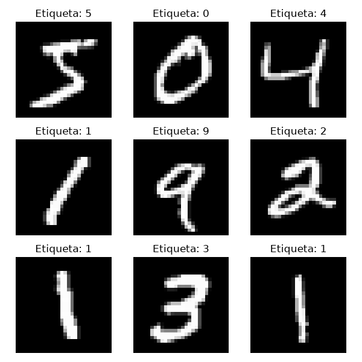
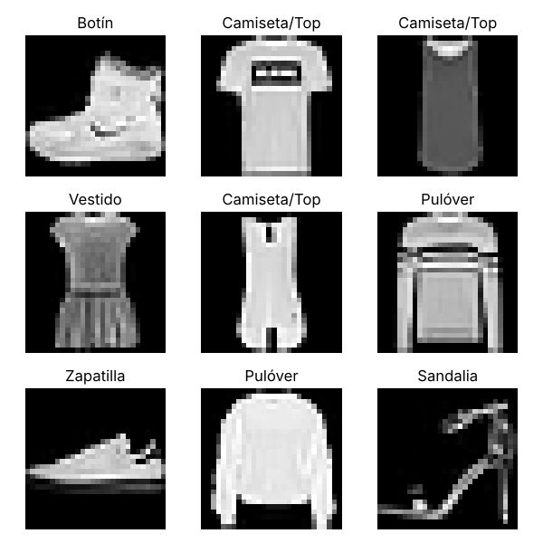

### Cómo ejecutar

```bash
pip install tensorflow matplotlib numpy
python mnist_cnn.py
python fashion_cnn.py
```

Cada script abre una ventana con 9 imágenes del dataset (y la guarda como `.png`), muestra el `model.summary()`, entrena 1 época con 5000 muestras y predice la primera imagen de prueba.

> **Corrección al código de la guía:** en `fashion_cnn.py`, la última línea `print(f"Clase real: ... (Índice {y_test[0]})} ")` tiene una llave `}` sobrante que provoca `SyntaxError: f-string: single '}' is not allowed`. Se corrigió a `(Índice {y_test[0]})")`. También se añadió una línea que imprime la suma del vector Softmax y un `plt.savefig()` para guardar la evidencia visual.

---

# PARTE 1: Dígitos escritos a mano (MNIST)

## Resultados obtenidos en consola

**`model.summary()`**

| Capa | Tipo | Output Shape | Parámetros |
|---|---|---|---|
| Conv_1 | Conv2D (32 filtros, 3×3) | (None, 26, 26, 32) | 320 |
| MaxPool_1 | MaxPooling2D (2×2) | (None, 13, 13, 32) | 0 |
| Conv_2 | Conv2D (64 filtros, 3×3) | (None, 11, 11, 64) | 18,496 |
| MaxPool_2 | MaxPooling2D (2×2) | (None, 5, 5, 64) | 0 |
| Aplanado_Flatten | Flatten | (None, 1600) | 0 |
| Capa_Densa_Oculta | Dense (64, ReLU) | (None, 64) | 102,464 |
| Salida_Softmax | Dense (10, Softmax) | (None, 10) | 650 |
| **Total** | | | **121,930** (476.29 KB) |

**Entrenamiento (1 época, 79 lotes de 64):**

```
79/79 ━━━━━━━━━━━━━━━━━━━━ 2s 10ms/step - accuracy: 0.7688 - loss: 0.8058
```

**Predicción sobre `X_test[0]`:**

```
Vector de probabilidades crudas (Softmax):
[0.000e+00 0.000e+00 1.000e-04 1.000e-04 0.000e+00 1.000e-04 0.000e+00
 9.994e-01 0.000e+00 4.000e-04]
Suma de las 10 probabilidades: 1.0000
Clase predicha por el modelo: 7
Clase real de la imagen: 7
```

## Actividades de Análisis (Parte 1)

### 1. Inspección visual del dataset



La cuadrícula muestra las 9 primeras imágenes de entrenamiento con etiquetas **5, 0, 4, 1, 9, 2, 1, 3, 1**. Observaciones:

- Cada imagen es una matriz de **28×28 píxeles en escala de grises** (valores 0–255). El fondo es negro (0) y el trazo es blanco/gris claro (valores altos).
- Los dígitos están **centrados** y ocupan la zona media de la imagen; los bordes son casi siempre negros.
- Los trazos son **líneas delgadas y continuas** con bordes suavizados (píxeles grises intermedios por el antialiasing).
- Hay **variación de escritura**: el "1" aparece inclinado en una muestra y recto en otras; el "9" tiene el lazo abierto; el "2" tiene un bucle en la base. Esto demuestra que la red no puede memorizar una plantilla fija, sino que debe aprender rasgos (curvas, líneas verticales, cierres).

**¿Por qué es útil visualizar antes de entrenar?** Permite confirmar que las etiquetas corresponden a las imágenes, conocer el rango de valores (lo que justifica dividir entre 255 para normalizar a [0, 1]), entender la forma del tensor (28×28 sin canal, por eso se usa `np.expand_dims` para obtener 28×28×1) e identificar la variabilidad real de los datos, que determina qué tan compleja debe ser la arquitectura.

### 2. Inspección de `model.summary()` y shapes

**Conv_1: de 28×28 a 26×26.** Una convolución sin *padding* (`padding='valid'`, valor por defecto) solo coloca el kernel en posiciones donde cabe completo dentro de la imagen. La fórmula es:

```
Salida = (Entrada − Kernel) / Stride + 1 = (28 − 3) / 1 + 1 = 26
```

El kernel de 3×3 "pierde" 1 píxel en cada borde (2 por dimensión), porque su centro no puede ubicarse sobre la primera ni la última fila/columna. Como hay 32 filtros, la salida es **26×26×32**: 32 mapas de características, cada uno detectando un patrón distinto (bordes, esquinas, trazos diagonales).

**MaxPool_1: de 26×26 a 13×13.** La capa toma ventanas de 2×2 sin solapamiento (stride = 2) y conserva solo el valor máximo de cada ventana:

```
Salida = 26 / 2 = 13  →  13×13×32
```

Reduce a la mitad el ancho y el alto (a la cuarta parte el número de valores), **no tiene parámetros entrenables** y no cambia el número de canales. Conserva la activación más fuerte de cada zona, lo que hace a la red más tolerante a pequeños desplazamientos del trazo y reduce el costo computacional de las capas siguientes.

El mismo razonamiento continúa: Conv_2 → (13 − 3) + 1 = **11×11×64**; MaxPool_2 → ⌊11 / 2⌋ = **5×5×64** (la última fila/columna impar se descarta).

### 3. Análisis de parámetros

**Conv_2 = 18,496 parámetros.** Cada uno de los 64 filtros recorre los 32 canales que produce MaxPool_1, así que cada filtro tiene un kernel de 3×3×32 pesos más 1 sesgo:

```
Pesos  = (alto_kernel × ancho_kernel × canales_entrada) × filtros
       = (3 × 3 × 32) × 64 = 288 × 64 = 18,432
Sesgos = 1 por filtro = 64
Total  = 18,432 + 64 = 18,496 ✔
```

Como verificación, Conv_1 = (3 × 3 × 1) × 32 + 32 = **320** ✔ (1 solo canal de entrada).

**Función de Flatten.** Las capas convolucionales trabajan con tensores 3D (alto × ancho × canales), pero una capa `Dense` solo acepta vectores 1D. `Flatten` convierte el tensor de MaxPool_2 en un vector, sin parámetros y sin perder información:

```
5 × 5 × 64 = 1,600 valores
```

Es el **puente estructural** entre la parte de *extracción de características* (convoluciones) y la de *clasificación* (densas). Su tamaño determina el costo de la capa siguiente: Capa_Densa_Oculta = 1,600 × 64 + 64 = **102,464** parámetros (el 84 % del total del modelo). Salida_Softmax = 64 × 10 + 10 = **650**.

### 4. Interpretación de resultados en consola

Vector Softmax obtenido (índice = dígito):

| Índice | 0 | 1 | 2 | 3 | 4 | 5 | 6 | **7** | 8 | 9 |
|---|---|---|---|---|---|---|---|---|---|---|
| Prob. | 0.0000 | 0.0000 | 0.0001 | 0.0001 | 0.0000 | 0.0001 | 0.0000 | **0.9994** | 0.0000 | 0.0004 |

**Suma:** 0.0001 + 0.0001 + 0.0001 + 0.9994 + 0.0004 = 1.0001 con los valores redondeados a 4 decimales; la suma exacta impresa por el script es **1.0000**. La diferencia de 0.0001 es solo error de redondeo.

**¿Qué representa?** Softmax transforma los 10 valores de salida (logits) en una **distribución de probabilidad**: `pᵢ = e^(zᵢ) / Σ e^(zⱼ)`. Por construcción todos los valores son positivos y suman 1 (100 %), por lo que cada valor se interpreta como la probabilidad que el modelo asigna a que la imagen pertenezca a esa clase.

**Cómo decide `np.argmax()`.** La función recorre el vector y devuelve el **índice** (no el valor) del elemento más alto. Aquí el máximo es 0.9994 en la posición 7, así que `np.argmax(predicciones)` = **7**. Como las clases de MNIST están ordenadas del 0 al 9, el índice coincide directamente con el dígito. Al contrastarlo con `y_test[0] = 7`, la predicción es **correcta**, y con una confianza del 99.94 %. La segunda opción más probable fue el 9 (0.04 %), lo cual tiene sentido porque un 7 y un 9 comparten un trazo superior horizontal y una línea descendente.

---

# PARTE 2: Clasificación de prendas (Fashion-MNIST)

## Resultados obtenidos en consola

**`model.summary()`**

| Capa | Tipo | Output Shape | Parámetros |
|---|---|---|---|
| Conv_1 | Conv2D (32, 3×3) | (None, 26, 26, 32) | 320 |
| MaxPool_1 | MaxPooling2D | (None, 13, 13, 32) | 0 |
| Conv_2 | Conv2D (64, 3×3) | (None, 11, 11, 64) | 18,496 |
| MaxPool_2 | MaxPooling2D | (None, 5, 5, 64) | 0 |
| Aplanado_Flatten | Flatten | (None, 1600) | 0 |
| Capa_Densa_Oculta | Dense (**128**, ReLU) | (None, 128) | **204,928** |
| Salida_Softmax | Dense (10, Softmax) | (None, 10) | **1,290** |
| **Total** | | | **225,034** (879.04 KB) |

**Entrenamiento (1 época):**

```
79/79 ━━━━━━━━━━━━━━━━━━━━ 2s 11ms/step - accuracy: 0.6544 - loss: 0.9915
```

**Predicción sobre `X_test[0]`:**

```
Vector de probabilidades crudas (Softmax):
[4.000e-04 0.000e+00 2.700e-03 2.000e-04 4.000e-04 1.665e-01 1.900e-03
 2.422e-01 1.193e-01 4.663e-01]
Suma de las 10 probabilidades: 1.0000
Clase predicha: Botín (Índice 9)
Clase real: Botín (Índice 9)
```

## Actividades de Análisis (Parte 2)

### 1. Inspección visual del dataset



Las 9 primeras imágenes son: **Botín, Camiseta/Top, Camiseta/Top, Vestido, Camiseta/Top, Pulóver, Zapatilla, Pulóver, Sandalia**. Diferencias estructurales frente a MNIST:

| Aspecto | MNIST (dígitos) | Fashion-MNIST (prendas) |
|---|---|---|
| Forma | Trazos delgados de 1–3 px | Siluetas **rellenas** que ocupan casi toda la imagen |
| Intensidad | Casi binaria (negro/blanco) | Muchos **tonos de gris** intermedios |
| Detalle interno | Ninguno; solo el contorno del trazo | **Texturas**: rayas del pulóver, estampado de la camiseta, pliegues del vestido, cordones del botín |
| Ocupación | Centro de la imagen, bordes vacíos | La prenda llega casi a los bordes |
| Variabilidad dentro de una clase | Moderada (estilos de escritura) | Alta: las tres "Camiseta/Top" son muy distintas (una con estampado, una sin mangas oscura, una de tirantes) |
| Similitud entre clases | Baja (salvo pares como 4/9, 3/8) | Alta: Camiseta, Camisa, Pulóver y Abrigo tienen siluetas casi iguales; Zapatilla, Sandalia y Botín comparten forma de calzado |

Además, la sandalia está formada por tiras finas con mucho espacio vacío, mientras que el pulóver es un bloque casi sólido: la misma clase "calzado" o "parte superior" puede verse muy diferente según el modelo de prenda. Por todo esto, Fashion-MNIST exige que la red aprenda **texturas y proporciones**, no solo contornos.

### 2. Análisis de la salida nominal (`class_names`)

La red solo produce números: un vector de 10 probabilidades y, tras `np.argmax()`, un **entero entre 0 y 9**. Ese entero no tiene significado por sí mismo; en MNIST coincide con el dígito por casualidad, pero en Fashion-MNIST el índice 9 no "es" nada visualmente.

El arreglo `class_names` actúa como una **tabla de traducción (mapeo índice → etiqueta)**, en el mismo orden en que el dataset codificó sus clases:

```python
indice_predicho = np.argmax(predicciones)    # → 9
class_names[indice_predicho]                 # → 'Botín'
class_names[y_test[0]]                       # → 'Botín'
```

Así, la salida abstracta `9` se convierte en la categoría legible **"Botín"**, tanto para la predicción como para la etiqueta real. Esto permite evaluar el resultado de forma inmediata y además leer el vector Softmax con sentido: el 16.65 % del índice 5 significa "Sandalia" y el 24.22 % del índice 7 significa "Zapatilla". Si el orden de `class_names` no coincidiera con la codificación del dataset, todas las predicciones se mostrarían con nombres incorrectos aunque la red acertara.

### 3. Impacto de la capa densa modificada (64 → 128 neuronas)

| Capa | MNIST (64 neuronas) | Fashion (128 neuronas) | Cálculo (Fashion) |
|---|---|---|---|
| Conv_1 + Conv_2 | 18,816 | 18,816 | sin cambio |
| Capa_Densa_Oculta | 102,464 | 204,928 | 1,600 × 128 + 128 |
| Salida_Softmax | 650 | 1,290 | 128 × 10 + 10 |
| **Total** | **121,930** | **225,034** | **+103,104 (+84.6 %)** |

Duplicar las neuronas de la capa oculta casi **duplica el total de parámetros**, porque esa capa está conectada a los 1,600 valores del Flatten: cada neurona nueva añade 1,600 pesos + 1 sesgo, más 10 conexiones hacia la salida. Las capas convolucionales no cambian (por eso el aumento es casi exclusivo de la parte densa).

**Implicancia:** las prendas tienen combinaciones de rasgos más ricas (forma de las mangas + longitud + textura + cuello) y clases muy parecidas entre sí. Una capa densa más ancha tiene más **capacidad** para combinar las características extraídas por las convoluciones y separar clases difíciles como Camiseta/Camisa/Pulóver. El costo es mayor memoria (879 KB vs. 476 KB), más cómputo por paso (11 ms vs. 10 ms) y más datos/épocas necesarios para ajustar esos pesos; con solo 5000 muestras y 1 época, el modelo más grande todavía no aprovecha toda su capacidad y, si se entrenara mucho tiempo con pocos datos, tendría mayor riesgo de sobreajuste.

---

# PARTE 3: Análisis comparativo entre ambos algoritmos y datasets

## 1. Comparativa de métricas de entrenamiento

| Métrica (1 época, 5000 muestras) | MNIST | Fashion-MNIST |
|---|---|---|
| Accuracy | **0.7688** (76.9 %) | 0.6544 (65.4 %) |
| Loss | **0.8058** | 0.9915 |
| Parámetros | 121,930 | 225,034 |
| Tiempo por paso | 10 ms | 11 ms |

> Nota: la *accuracy* y *loss* que imprime Keras son el **promedio a lo largo de toda la época**, incluidos los primeros lotes en los que la red aún adivinaba al azar (≈ 10–17 % de accuracy y loss ≈ 2.30 = ln 10). Por eso los valores finales parecen bajos aunque la red ya clasifica bien al terminar.

**La red aprende más rápido y de forma más eficiente con MNIST:** obtiene 11.4 puntos más de accuracy y una pérdida ≈ 19 % menor, **con casi la mitad de parámetros**. En la evolución lote a lote se nota que MNIST supera el 70 % de accuracy hacia el lote 54, mientras que Fashion-MNIST se queda alrededor del 65 % al final.

**¿Por qué?** Los dígitos son trazos simples sobre fondo vacío y sus clases están bien separadas: unos pocos filtros de bordes y curvas bastan para distinguirlos. En Fashion-MNIST las clases se solapan visualmente (Camiseta/Camisa/Pulóver/Abrigo; Sandalia/Zapatilla/Botín), así que el gradiente de las primeras iteraciones es menos informativo y la red necesita más datos y épocas para encontrar los rasgos discriminantes. Aunque Fashion tenga una capa densa más grande, una mayor capacidad no acelera el aprendizaje cuando el problema es intrínsecamente más ambiguo.

## 2. Complejidad visual y de patrones

- **Dígitos:** trazos delgados, centrados, casi binarios, con fondo vacío. Toda la información está en la **forma del contorno** (líneas, curvas, cierres). Los filtros de Conv_1 detectan bordes y Conv_2 los combina en partes (bucle del 9, horizontal del 7), lo que basta para separar las clases.
- **Prendas:** siluetas rellenas que ocupan casi toda la imagen, con texturas, estampados, pliegues y degradados de gris. La silueta de varias clases es casi idéntica y la diferencia está en **detalles finos** (botones de la camisa, cuello del pulóver, tiras de la sandalia), que a 28×28 píxeles y después de dos MaxPooling se pierden parcialmente.

**Efecto en Softmax:** cuando las características de una clase son únicas, los logits de esa clase quedan muy por encima del resto y la exponencial de Softmax concentra casi toda la probabilidad en una sola salida (MNIST: 99.94 %). Cuando varias clases activan características similares, sus logits quedan cercanos y Softmax reparte la probabilidad entre ellas, reduciendo la confianza (Fashion: 46.63 %).

## 3. Distribución de confianza del modelo

| | MNIST (`X_test[0]` = 7) | Fashion-MNIST (`X_test[0]` = Botín) |
|---|---|---|
| Clase ganadora | 7 → **99.94 %** | Botín → **46.63 %** |
| 2.ª opción | 9 → 0.04 % | Zapatilla → 24.22 % |
| 3.ª opción | 2, 3, 5 → 0.01 % c/u | Sandalia → 16.65 % |
| 4.ª opción | — | Bolso → 11.93 % |
| Masa fuera de la clase correcta | 0.06 % | 53.37 % |
| Tipo de distribución | **Fuertemente dominante (pico único)** | **Dispersa** |

**MNIST** muestra un valor **fuertemente dominante**: la red está prácticamente segura. Las demás clases tienen probabilidad casi nula.

**Fashion-MNIST** muestra una distribución **dispersa**: aunque acierta (Botín), lo hace con **menos de la mitad** de la probabilidad. El resto se reparte de forma muy lógica entre **los otros tipos de calzado** (Zapatilla y Sandalia suman 40.87 %) y el Bolso (11.93 %, objeto compacto sin mangas, similar en masa visual a un zapato). En cambio, las prendas superiores (Camiseta, Pulóver, Abrigo, Camisa) y el Pantalón tienen probabilidades ≈ 0. Esto indica que la red **ya aprendió la categoría general "calzado"**, pero aún no distingue con seguridad entre sus subtipos.

**Conclusión:** el dominio de los datos determina directamente la certeza de la red. Con la misma arquitectura base, mismos datos de entrenamiento (5000) y mismo número de épocas, un dominio visualmente simple y con clases bien separadas (MNIST) produce predicciones casi deterministas, mientras que un dominio con texturas, alta variabilidad interna y clases parecidas (Fashion-MNIST) produce predicciones correctas pero inciertas. Para Fashion-MNIST convendría entrenar más épocas con el dataset completo (60,000 imágenes), añadir más filtros o capas convolucionales, usar *padding='same'* para conservar detalles de los bordes, y aplicar *Dropout* para controlar el sobreajuste del modelo más grande.

---


